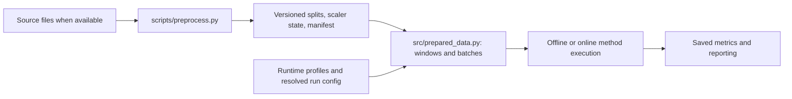

# Proposed next-version tree

Updated: 2026-11-16
Status: runtime design proposal. Preprocessing and required data processing are complete. The proposed runtime modules and installed CLI are not implemented by this document.
Project: `bachelor-thesis-2026`.

Proposed Python interfaces: [runtime signatures](../../../2026-11-16/detail/proposed-runtime-signatures.md). These are design material, not implemented source.

The two MUSTARD q95 evaluation profiles use the offline threshold reuse rules in the [runtime profile contract](../../../2026-11-16/detail/runtime-profile-contract.md#mustard-validation-q95-comparison).

## Confirmed runtime boundary: 2026-11-16

Follow the [runtime replacement decisions](../../../2026-11-16/plan/decisions-runtime-replacement.md).

1. `encoders.py` owns one time-preserving CNN implementation shared by MUSTARD, RedLamp, CANDI, and M2N2. Each method owns separate weights, pooling, heads, and update state. CANDI's SANA stays method-specific; MOMENT retains its pretrained encoder.
2. Runtime loading reads prepared data without new splits, filling, or scaling. Keep the self-contained preprocessing script and active `scripts/cleandocs_hook.py`.
3. Preserve core method calculations where the confirmed decisions permit. Document departures from author code. RedLamp uses validation-fixed scoring and causal smoothing.
4. The agreed result hierarchy replaces the older depth maximum. New commands and checkpoints replace old interfaces. Remove each old implementation only after its replacement checks pass.

## Goal and current status

1. Use one self-contained preprocessing script and a small set of runtime workflow files. Keep MUSTARD, its O0–O2 and A0–A2 variants, and all seven retained comparison methods.
2. All required ICCAD, SMD, IOPS, NASA, and SWaT data is processed. Prepared manifests cover 1, 28, 29, 80, and 1 entities, respectively. Original source folders were removed after processing and saved-output checks.
3. NASA excludes P-2 and T-10. SWaT uses the trimmed early normal recording for training and the complete later mixed-label recording for testing. Keep the approved seven-feature exclusion.
4. Cleanup of confirmed unnecessary files is complete. Keep required current code until replacement behavior is verified. Protect specifications, detailed mathematics, required reference code, and licenses. Do not create local archives.
5. The latest recorded temporary preprocessing suite has 46 tests. These results do not establish runtime method parity, complete every earlier dataset audit, or prove publisher provenance.

## File-level tree

This tree follows the simpler 2026-11-16 proposal. Python and YAML filenames below are proposed unless already implemented. Entity and version paths are templates. Protected specifications and detailed mathematics outside this excerpt remain protected.

```text
bachelor-thesis-2026/
├── README.md                         # Setup and main commands
├── AGENTS.md
├── codebase-agnostic-preferences.md
├── codebase-specific-preferences.md
├── python_semantics.md
├── MAIN_FOLDERS.md
├── LICENSE
├── .gitignore                        # Include .codex/ and generated outputs
├── pyproject.toml                    # Proposed package and tsad entrypoint
├── scripts/
│   ├── __init__.py
│   ├── cleandocs_hook.py             # Active report-only documentation hook
│   └── preprocess.py                 # Existing self-contained preprocessing
├── configs/
│   ├── data_profiles/
│   │   ├── iccad.yaml
│   │   ├── smd.yaml
│   │   ├── iops.yaml
│   │   ├── swat.yaml
│   │   ├── nasa.yaml
│   │   └── synthetic_profiles/
│   │       ├── redlamp_legacy.yaml
│   │       └── redlamp_visible.yaml
│   ├── method_profiles/
│   │   ├── mustard_o0_offline.yaml
│   │   ├── mustard_o1_offline.yaml
│   │   ├── mustard_o2_offline.yaml
│   │   ├── mustard_a0_online.yaml
│   │   ├── mustard_a1_online.yaml
│   │   ├── mustard_a2_online.yaml
│   │   └── baselines/
│   │       ├── redlamp.yaml
│   │       ├── stumpy_channel_ab.yaml
│   │       ├── kmeans_ad.yaml
│   │       ├── iforest.yaml
│   │       ├── candi.yaml
│   │       ├── m2n2.yaml
│   │       ├── moment.yaml
│   │       └── moment_linear_probing.yaml
│   ├── evaluation_profiles/
│   │   ├── raw_input_q99_ewma075.yaml
│   │   ├── native_q99_ewma075.yaml
│   │   ├── mustard_raw_input_q95_ewma075.yaml  # Raw MSE
│   │   ├── mustard_latent_q95_ewma075.yaml     # Latent MSE
│   │   └── smd/
│   │       ├── cleanval_q99_ewma09.yaml
│   │       ├── cleanval_q995_ewma09.yaml
│   │       ├── synthnormal_q99_ewma09.yaml
│   │       └── synthnormal_q99_normalized_input_mse_ewma09.yaml
│   ├── reporting_profiles/
│   │   ├── offline_detection.yaml
│   │   ├── online_detection.yaml
│   │   └── uncertainty.yaml
│   ├── metrics.yaml                  # Shared metric names and display precision
│   ├── experiments/
│   │   └── smd_comparison.yaml        # Example experiment definition
│   └── standalones/
│       └── smd_mustard.yaml           # Example standalone definition
├── src/
│   ├── __init__.py
│   ├── cli.py                        # Parse commands and call workflow functions
│   ├── config.py                     # Resolve profiles, defaults, and known names
│   ├── experiments.py                # Edit definitions and expand planned runs
│   ├── prepared_data.py              # Read prepared data; make windows and batches
│   ├── offline.py                    # Fit, select state, calibrate, and evaluate
│   ├── online.py                     # Score each window before optional updates
│   ├── scoring.py                    # Score transforms, smoothing, and calibration
│   ├── evaluation_metrics.py         # Detection and uncertainty metrics
│   ├── reporting.py                  # Find runs and write detailed/mean-only CSV
│   ├── artifacts.py                  # IDs, paths, status, checkpoints, and recovery
│   ├── integrations.py               # Separate W&B logging and Kaggle backup calls
│   ├── encoders.py                   # Encoder construction shared by eligible methods
│   ├── methods/
│   │   ├── __init__.py
│   │   ├── augmentation.py           # Method training augmentation, not source cleaning
│   │   ├── mustard/
│   │   │   ├── __init__.py
│   │   │   ├── model.py              # Public method entrypoint and lifecycle
│   │   │   ├── retrieval.py          # Prototype bank and discrete codebook
│   │   │   ├── losses.py
│   │   │   ├── state.py              # Method state encoding and restoration
│   │   │   └── online_update.py       # MUSTARD update computation
│   │   └── baselines/
│   │       ├── __init__.py
│   │       ├── redlamp.py
│   │       ├── stumpy_channel_ab.py
│   │       ├── kmeans_ad.py
│   │       ├── iforest.py
│   │       ├── candi.py
│   │       ├── m2n2.py
│   │       └── moment.py
│   └── protocols/
│       ├── __init__.py
│       ├── run_evaluation.py
│       ├── data_stream.py
│       ├── scoring_calibration.py
│       └── method_updates.py
├── tests/
│   ├── conftest.py
│   ├── test_preprocess.py             # Proposed permanent preprocessing tests
│   ├── test_cli.py
│   ├── test_config.py
│   ├── test_experiments.py
│   ├── test_data.py
│   ├── test_offline.py
│   ├── test_online.py
│   ├── test_scoring.py
│   ├── test_metrics.py
│   ├── test_reporting.py
│   ├── test_artifacts.py
│   ├── test_integrations.py
│   ├── test_encoders.py
│   ├── test_mustard.py
│   ├── test_baselines.py
│   └── test_protocols.py
├── documents/
│   ├── specs/
│   │   ├── definitions.md
│   │   ├── desired-cli-20261109.md
│   │   ├── config-profiles-flow.md
│   │   ├── protocol-validation-rules.md
│   │   └── current-protocol-validation-rules.md
│   └── logs/
│       └── 2026-11-16/
│           ├── plan/
│           │   └── decisions-tsad-preprocess.md
│           ├── research/
│           │   └── research-missing-data-options.md
│           └── structure/
│               └── proposed-next-version-tree.md
├── data/
│   └── preprocessed/
│       ├── iccad/<version_id>/        # 1 Console entity
│       ├── smd/<version_id>/          # 28 machine entities
│       ├── iops/<version_id>/         # 29 entities
│       ├── nasa/<version_id>/         # 80 channels; exclude P-2 and T-10
│       └── swat/<version_id>/         # 1 entity; approved reconstructed splits
└── bsc-thesis-ref-codebases/          # Only required references and their licenses
```

Example YAML filenames do not require creating every file now. O2 and MOMENT remain in scope; listing their files does not prove runtime readiness. Current required source, configs, and tests remain until their replacements pass the relevant checks.

## Preprocessing and runtime ownership

1. `scripts/preprocess.py` owns source reading, sorting, split boundaries, approved missing-value handling, training-only input scaling, and prepared-data versioning. Keep it runnable without `src/` or required external YAML files.
2. The script's built-in profiles supply defaults. An optional preprocessing YAML supplies supported overrides. Do not duplicate those defaults in five runtime profiles.
3. `configs/data_profiles/<dataset>.yaml` selects one prepared version through the proposed `prepared_root` field. It also holds window, stride, batch, worker, and training-window shuffle settings. It does not hold raw split ratios or fit an input scaler.
4. `src/prepared_data.py` reads prepared splits and metadata, then creates windows and batches. It must not split observations again, repair source values, or scale already transformed features again.
5. Offline and online runs use compatible references to the same prepared-data version and saved input-scaler state. Record those references in run provenance and check them when selecting an offline parent.
6. Method-specific synthetic augmentation remains separate from source preparation. It must not silently replace saved source splits or refit their input scaler. Preserve version and provenance rules for generated data.
7. The future `tsad preprocess` command calls the existing script implementation. Source deletion remains a separate action. New preprocessing or source-based repeat checks require source files; prepared outputs do not restore the removed inputs.



## Prepared output files

```text
data/preprocessed/<dataset>/<version_id>/
├── manifest.json
└── <entity>/
    ├── train.parquet
    ├── validation.parquet
    ├── test.parquet
    └── scaler.json
```

1. Preserve feature order, labels, optional timestamps, source row mapping, and fitted scaler state. Unknown labels remain unknown.
2. Version identity uses selected source hashes, resolved preprocessing settings, and the code hash. Reuse requires a complete matching version; incomplete or damaged versions stop without automatic overwrite.
3. One complete NASA version remains. Two SWaT versions remain; this proposal does not select or delete either. Runtime profiles must reference an explicit version.
4. Usable window lengths and window behavior across gaps belong to later runtime loading. Exact source provenance remains unresolved where documented.

## CLI and workflow files

1. `src/cli.py` exposes the desired discovery, experiment editing, validation, smoke, run, resume, and reporting commands. It parses arguments and calls the owning workflow; it does not copy processing logic.
2. `src/config.py` resolves profiles, defaults, and known names. This flat path replaces the earlier proposed `src/core/config.py` location. The configuration plan remains the source for proposed resolver behavior and signatures; no source migration is performed here.
3. `src/experiments.py` owns experiment definitions and planned run expansion. The desired CLI allows applicable method–dataset combinations. Reconcile its exact expansion rules with the earlier seed-only plan before implementation.
4. `src/offline.py` and `src/online.py` own phase execution. `src/scoring.py` owns shared score transforms, smoothing, and calibration. Keep method mathematics and updates with the method.
5. `src/artifacts.py` owns IDs, paths, status, checkpoint storage, offline-parent lookup, and recovery records. Method entrypoints own their state contents. Split this module only if actual code requires it.
6. `src/reporting.py` reads run results and writes detailed and mean-only CSV tables. `src/integrations.py` separates W&B logging from Kaggle backup.
7. `src/encoders.py` constructs encoders for eligible methods. Use separate method-owned weights and mutable state. Equal initialization is not required.
8. The desired CLI replaces routine config generators, phase launchers, comparison wrappers, and result collectors as separate required scripts. Retire current wrappers only after callers and documented commands are migrated.

## Config file details

1. Keep four profile types: data, method, evaluation, and reporting. An experiment uses one runtime data profile per dataset.
2. Method profiles hold method settings and distinct parameter sets. MUSTARD variant names remain method-specific. Keep MOMENT under baselines.
3. Evaluation profiles hold scoring and calibration choices. Reporting profiles select and format existing results without changing runs or their underlying metrics.
4. `configs/metrics.yaml` is the proposed home for shared metric names and display precision. Reporting profiles may rarely override precision. Complete schemas remain proposed.
5. Experiment YAML describes a comparison with multiple runs, shared seeds, and reporting profiles. Standalone YAML describes one run. A standalone user may supply a unique `run_id`; otherwise generate one. Experiment run IDs are generated. Repeated execution gets a new ID; resume retains its ID.
6. Keep the agreed standalone default `outputs/standalones/<run_id>/`. Experiment output paths follow the hierarchy below.
7. General parsing and profile resolution belong in `src/config.py`. The four protocols check context-specific inputs and outputs. Protocols do not own YAML values or execute methods.

## Experiment output and reporting layout


Experiment outputs use this full hierarchy; `phase` and `split` are always present, and dataset, entity, method, variant, and seed folders are omitted under the agreed single-value rules. Create only split folders with results. An execution has the same `run_id` in each split it produces.

```text
outputs/<experiment_id>/<phase>/<dataset>/<data_entity>/<method_name>/<ablation_variant>/<random_seed>/<split>/<run_id>/
```

1. Keep separate run ID folders for repeated executions. The aggregator uses the configured dimensions and result metadata to interpret omitted folders and select matching runs.
2. Each split records metadata and metrics in JSON. Each dataset table covers one phase and may contain multiple splits; the exact column names and file locations remain open.
3. Reporting cells aggregate one metric for an entity and method variant over the shared seeds. Select the latest eligible successful run by start time for each seed; exclude missing and non-finite values. Report the mean, sample standard deviation, and valid/expected count; show `N/A` where a value is unavailable.
4. Write a detailed CSV using `mean ± standard deviation (valid/expected)` and a simplified mean-only CSV. A method with no specified ablation uses `default`, traceable to the method profile path in run metadata.
5. For an online experiment run, find the latest successful compatible offline run within the same experiment for the required offline variant and seed. Load its best checkpoint and required calibration artifacts. Check that offline and online runs reference the same prepared-data version and saved input-scaler state. Do not transform already scaled features again. Stop if a required artifact is missing. Exact compatibility fields, artifact selection, and tie-breaking details remain open.

## Protocol file details


Each file owns input and output validation rules for one context. Keep small checks with their owning protocol. Add shared helpers only when actual repeated code needs them. Do not require a separate contracts module. The current code spreads these checks across several modules, so this tree describes a proposed next-version layout.

1. `src/protocols/run_evaluation.py`
   1. Input checks: run identity, required and allowed config fields, variant and seed consistency, and evaluation restrictions such as test labels being used for metrics only.
   2. Output checks: required model-output fields and ranks, evaluation score/label alignment, and evaluation-record lengths and types.
   3. Keep general config parsing in `src/config.py`; this file owns rules that apply to a research run or its evaluation.
2. `src/protocols/data_stream.py`
   1. Input checks: runtime data settings, prepared manifest and split fields, selected entity and feature schema, stream-range bounds, supported stream mode, and saved scaler identity. Raw-source checks remain in the preprocessing script.
   2. Output checks: window and batch structure, required metadata, and online absolute-index shape, type, and order.
   3. State any unchecked alignment rule explicitly. The current window validator, for example, does not check that every optional field has the same length as `x`.
3. `src/protocols/scoring_calibration.py`
   1. Input checks: score-space and transform choices, reconstruction shapes and finiteness, calibration inputs, threshold settings, and threshold-artifact identity and provenance.
   2. Output checks: finite reconstruction scores, per-window score lengths, EWMA weight sum, calibration values, and threshold-artifact fields and ordering.
   3. Preserve data-source limits: test labels do not select thresholds, and normalized-input scores use the required synthetic-normal validation source.
   4. The current aggregator returns a coverage mask but does not enforce full coverage. Keep that gap visible and add a coverage rule only where the run requires it.
4. `src/protocols/method_updates.py`
   1. Input checks: supported online variant, optimizer target and type, trainable-parameter rules, one-window input, triage thresholds, update-loss shapes, and verification inputs.
   2. Output checks: update-result fields, finite loss and parameters, allowed parameter changes, and consistency between the recorded score and the update from that window.
   3. The current code has no general post-update output validator. Add one here in the next version; do not describe the existing pre-update parameter check as post-update validation.

The four files validate values entering and leaving their context. They do not contain method implementations or run the experiment. Checking whether an implementation provides required methods uses a Markdown checklist and `grep`. It remains a separate procedure, not a fifth protocol. A dedicated checklist filename is not required by this tree.

## Terminology and migration

1. No domain terms are renamed. An experiment contains multiple runs. A cell fixes one run's settings. Protocols group related input and output validation rules.
2. Preprocessing ownership is `split`: source preparation belongs to `scripts/preprocess.py`; prepared-data loading and window creation belong to `src/prepared_data.py`.
3. The proposed raw-data `root` field is `deprecated`. `prepared_root` is `new` and selects one prepared version. Their meanings differ; do not migrate values by renaming the key alone.
4. The proposed `src/core/config.py` path is `renamed` to `src/config.py` in this tree. General resolver ownership stays the same. Existing source paths and signatures are not changed by this proposal.
5. Historical `THESIS` references map to the canonical method name `MUSTARD` only after the relevant code, configuration, checkpoint, and result contracts are checked. Preserve required mathematics and scientific comparisons.

## Remaining implementation checks

1. Map required current source, configs, tests, callers, and artifacts to their proposed owners before retiring them.
2. Specify runtime prepared-data validation, complete profile schemas, CLI defaults, smoke limits, and experiment expansion behavior.
3. Review method readiness, artifact compatibility, and recovery contracts. Encoder architecture sharing and state ownership are confirmed. Keep unresolved O2 and MOMENT evidence visible.
4. Verify representative offline, online, calibration, checkpoint, resume, and reporting flows before removing current implementations.
5. Implement the confirmed result hierarchy, which supersedes the older path-depth preference. Preserve historical paths; no migration is required.
6. Implement the installed `tsad preprocess` route without copying the script. Do not rerun preprocessing against the removed source folders.

## Evidence: eight recent updates

These documents supply decisions, implementation records, and limits. Their presence does not prove the proposed runtime is implemented.

1. [Preprocessing decisions](../../../2026-11-16/plan/decisions-tsad-preprocess.md).
2. [Preprocessing plan and current status](../../../2026-11-16/plan/plan-tsad-preprocess.md).
3. [Cleanup record](../../../2026-11-16/plan/plan-cleanup-next-version.md).
4. [Simpler current tree proposal](../../../2026-11-16/structure/proposed-next-version-tree.md).
5. [NASA annotation findings and final decision](../../../2026-11-16/research/research-nasa-p2-annotations.md).
6. [SWaT source findings and approved reconstruction](../../../2026-11-16/research/research-swat-source-timeline.md).
7. [Configuration signatures and fields](../../../2026-11-09/plan/plan-config-signatures-and-fields.md).
8. [Desired CLI](../../../../specs/desired-cli-20261109.md).

Use the [agreed definitions](../../../../specs/definitions.md) for terminology and the [current validation audit](../../../../specs/current-protocol-validation-rules.md) for existing checks.

## Phase 1 contract alignment: 2026-11-17

1. Follow the [profile contract](../../../2026-11-16/detail/runtime-profile-contract.md) and its ordered decision record for fields and defaults. Full-contract approval is pending.
2. `prepared_data.py` and `evaluation_metrics.py` avoid retained old-package collisions. Public function names stay unchanged.
3. Distribution `thesis-tsad` maps `thesis_tsad` to `src/` and `thesis_scripts` to `scripts/`. Install only in the thesis environment after checking command ownership.
4. Preserve gap segments, delayed score finalization, segment summaries, and recovery state. Keep smoke outputs separate from normal reports.
5. Use the state branch and artifact bindings in Stage 1.2 steps 7–10 for whole-run status, required stage checkpoints, and committed continuation.
