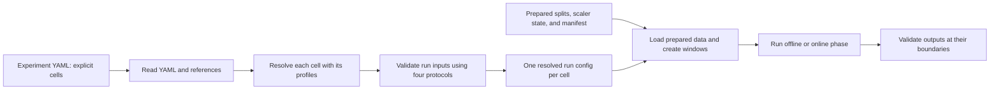

# Plan: next-version config signatures and YAML fields

Status: runtime configuration design proposal. Updated on 2026-11-16 for completed preprocessing. This plan does not implement the proposed runtime configuration or change YAML files.

Current signature proposal: [runtime signatures](../../2026-11-16/detail/proposed-runtime-signatures.md). It supersedes the function names and resolver ID-allocation behavior below: resolution is read-only; execution allocates IDs. Other confirmed configuration and reporting decisions remain in force.

## Confirmed replacement decisions: 2026-11-16

Follow the [runtime replacement decisions](../../2026-11-16/plan/decisions-runtime-replacement.md). Earlier conflicting proposals below are superseded.

1. Runtime data profiles reference prepared versions. Do not split, fill, or scale observations again.
2. The experiment selects common time-preserving CNN architecture and settings for MUSTARD, RedLamp, CANDI, and M2N2. Resolved method settings receive that selection; reject conflicting per-method encoder settings. Each method owns a separate instance and weights. Exact profile field placement remains to be specified.
3. Keep method-specific heads, pooling, losses, and updates. Keep CANDI's SANA separate. MOMENT retains its pretrained encoder and both documented variants.
4. Evaluation permits causal unlabeled adaptation after scoring. Test labels are for metrics only. Prohibit future observations, complete-test statistics, and test-based tuning.
5. RedLamp fixes class selection and score scaling from validation and uses causal smoothing. Exact settings remain subject to method review.
6. Smoke selects the first configured dataset, entity, applicable variant, and seed per method and supported phase, with required offline dependencies. Explicit work limits do not change prepared data. Exclude smoke results from normal reports.
7. Unsupported combinations stop validation. The agreed result hierarchy replaces the older depth maximum.
8. New runtime commands and checkpoints replace old interfaces without compatibility wrappers. Remove old code in stages after replacement checks pass.

## Goal and scope

Design a simple new `src/core/config.py` and the fields of the proposed `configs/` files. A clean rewrite is allowed. Current code is a high-level behavioral reference, not an implementation constraint. Preserve the required scientific comparisons, configuration meaning, and artifact behavior when the future implementation is verified.

The current high-level flow is in `../research/research-current-config-flow.md`. The terminology source is `documents/specs/definitions.md`; the file-level proposal is `documents/logs/2026-11-03/detail/phase2-reexecution/proposed-next-version-tree.md`. The specific method settings below are an initial schema, not a claim of complete scientific coverage.

## Preprocessing boundary: confirmed on 2026-11-16

1. All required ICCAD, SMD, IOPS, SWaT, and NASA data is processed. The original source folders were removed after checks.
2. One self-contained `scripts/preprocess.py` owns source reading, sorting, splitting, missing-value handling, input scaling, and prepared-data versioning. Built-in defaults are sufficient; an external preprocessing YAML is optional.
3. Runtime data profiles select a saved prepared version and define windows, strides, and batches. They do not split observations again, fill missing source values, or fit another input scaler.
4. A preprocessing override YAML and a runtime data profile have different fields. Do not pass a runtime profile to the script. Use `--show-profile` to inspect the supported preprocessing fields.
5. See [the confirmed preprocessing decisions](../../2026-11-16/plan/decisions-tsad-preprocess.md) and [the current tree proposal](../../2026-11-16/structure/proposed-next-version-tree.md). Runtime configuration remains proposed.

## Design principles

1. An **experiment** contains multiple runs. A **cell** is one resolved item fixing settings for one run. An experiment YAML entry describes a run template that expands into one cell per shared seed. A standalone run uses one cell without an experiment, stored under `configs/standalones/`. If `output_dir` is omitted, use `outputs/standalones/<run_id>/`.
2. YAML stores values. The four files in `src/protocols/` own context-specific input and output validation rules. General YAML parsing and reference resolution belong in `src/core/config.py`.
3. Data, method, evaluation, and reporting profiles own reusable settings. Reporting profiles select and present existing results; they do not change runs or compute the underlying metrics. A cell selects profiles and supplies run-specific settings. Each explicitly listed run template expands into one cell per seed in the experiment-wide seed list; no other implicit Cartesian product is generated.
4. Profiles and cells use explicit fields. Do not silently copy, rename, or discard scientific settings whose meaning is unconfirmed.
5. Offline and online are phases. Adaptation is optional method behavior. MUSTARD's O0–O2 and A0–A2 labels are method-specific.

## Confirmed identity decisions

1. A user may supply `experiment_id` for an experiment, but may not supply `run_id` values in its cells. The program generates each experiment run ID.
2. For a standalone run, a user may provide `run_id`; otherwise the program generates it. Reject a user-provided ID that already exists in the project and ask for a different ID.
3. Each repeated execution receives a different `run_id`, even when settings are unchanged. Every run ID must be unique across the project. Generated run IDs use UUIDv7. An interrupted run resumed from its checkpoint keeps its original `run_id`. Generated-ID collision handling remains open.

## Proposed flow



`config.py` does not run an experiment and does not validate outputs that do not exist yet. Runtime components call the appropriate protocol rules at their input and output boundaries.

## Proposed `src/core/config.py` interface

`Config` below means `dict[str, Any]`; it is a type alias, not a new class hierarchy. Paths are `pathlib.Path`. All functions below are proposed; none is claimed to exist today.

```python
from pathlib import Path
from typing import Any

Config = dict[str, Any]

def load_yaml(path: Path) -> Config: ...

def load_experiment(path: Path) -> Config: ...

def resolve_cell(cell: Config, *, configs_root: Path) -> Config: ...

def resolve_experiment(path: Path, *, configs_root: Path) -> list[Config]: ...

def load_standalone_run(path: Path, *, configs_root: Path) -> Config: ...
```

1. `load_yaml` reads UTF-8 YAML with a safe loader; it rejects a missing file, duplicate keys, an empty document, and a non-mapping root. Errors name the file and offending field where available.
2. `load_experiment` reads an experiment definition with `experiment_id` and a non-empty `cells` list. It checks only this envelope. Validate the number of runs after seed expansion: one template with multiple seeds can define multiple runs. A configuration resolving to only one run uses `load_standalone_run`.
3. `resolve_cell` loads the cell's selected profiles under `configs_root`, combines them with the cell, and returns one self-contained run config. The run and evaluation protocol validates its run identity and phase; data and stream validates data settings; scoring and calibration validates applicable evaluation settings; method updates validates applicable update settings. Validation calls are made only when their inputs are available. Outputs are validated later by the owner of each boundary.
4. `resolve_experiment` loads the experiment and resolves cells in listed order. It generates a project-unique `run_id` for each execution; users do not provide run IDs in experiment cells. Generated IDs use UUIDv7. It expands each explicit run template over the shared seed list and returns a list; it does not execute runs, expand other parameter combinations, or write files.
5. `load_standalone_run` reads one cell-shaped YAML document and resolves it through `resolve_cell`. It does not create an experiment.
6. Paths in `data_profile`, `method_profile`, and `evaluation_profile` are relative to `configs_root`; absolute paths and references escaping that root are rejected. The caller explicitly supplies the root, avoiding working-directory search rules.
7. The resolver preserves profile content under `data`, `method`, and `evaluation`, and includes `run_id`, `entity`, `seed`, `phase`, `device`, `output_dir`, `limits`, and `offline_run` as applicable. Experiment run output paths are derived, while standalone runs may supply `output_dir` explicitly. It records the selected relative paths under `profile_paths` for provenance. It does not mutate its inputs.
8. There are no general deep overrides of run profiles. Reporting profiles may make the agreed rare display-precision override. Other profile values come from their owner; cell fields supply only their defined run-specific values. Different shared settings require another profile. The reporting-precision override takes precedence over the shared metric default; its exact schema and provenance remain to be specified.
9. Fail with `FileNotFoundError` for a missing referenced file and `ValueError` for malformed YAML, invalid paths, or invalid envelope; protocol validators report invalid domain settings. Do not silently substitute a profile or default a missing required field.

## Proposed YAML fields

`required` means required in that file. `optional` means omitted fields have the stated meaning; there are no unstated defaults. Types describe YAML values. All names and examples below are proposed.

### 1. `configs/data_profiles/smd.yaml`

| Field | Type | Status | Meaning |
| --- | --- | --- | --- |
| `dataset` | string | required | Dataset name, `smd`. |
| `prepared_root` | string | required | One version directory containing `manifest.json` and entity folders, relative to the project root; for example, `data/preprocessed/smd/<version_id>`. |
| `window_size` | integer | required | Shared window length. |
| `train_stride`, `validation_stride`, `test_stride` | integer | required | Window step for each split. |
| `batch_size` | integer | required | Offline batch size. |
| `num_workers` | integer | required | Data loader workers. |
| `shuffle_train` | boolean | required | Whether to shuffle training windows. |
| `synthetic_profile` | string or null | optional | Path relative to `configs_root`; absent or null means no synthetic profile. |

The proposed `prepared_root` replaces the raw-data `root`. Split ratios and input-scaler choices belong to preprocessing settings and saved provenance, not this runtime profile. The runtime loader reads saved split files, feature order, labels, source row mapping, and scaler state. It checks dataset, entity, and version compatibility before creating windows. Exact runtime validation signatures remain to be designed.

Synthetic profile files under `configs/data_profiles/synthetic_profiles/` hold `min_segment_fraction`, `max_segment_fraction`, `spike_scale`, `anomaly_visibility_boost`, and `family_intensity` mapping when applicable. The exact per-family fields and whether a given method uses them need method-specific review. The cell selects the entity and any diagnostic stream range.

### 2. `configs/method_profiles/mustard_offline.yaml`

| Field | Type | Status | Meaning |
| --- | --- | --- | --- |
| `method` | string | required | `mustard`. |
| `phase` | string | required | `offline`. |
| `offline_variant` | string | required | MUSTARD O0, O1, or O2; O2 runtime evidence remains unresolved. |
| `model` | mapping | required | Model architecture, retrieval, and head settings. |
| `loss` | mapping | required | Loss terms, weights, and method-specific options. |
| `training` | mapping | required | Training stages, epochs, optimizer, and checkpoint selection. |

`model`, `loss`, and `training` are ownership boundaries, not complete schemas. Exact child fields, defaults, variant differences, and checkpoint contracts must be specified against the method research before this can be implemented without loss of scientific meaning. Window size has one owner: `data.window_size`; a method must consume it rather than supply a conflicting value.

### 3. `configs/method_profiles/mustard_online.yaml`

| Field | Type | Status | Meaning |
| --- | --- | --- | --- |
| `method` | string | required | `mustard`. |
| `phase` | string | required | `online`. |
| `online_variant` | string | required | MUSTARD A0, A1, or A2. |
| `projector` | mapping | required | Projector architecture and options. |
| `update` | mapping | required | Update policy, optimizer, loss, and parameter target when applicable. |
| `verification` | mapping | optional | Verification settings where supported by the selected method variant. |

A0 must not imply an update optimizer. Scoring occurs before an update. Exact child fields and whether an option applies to a variant remain open until the method contract is reviewed.

### 4. `configs/method_profiles/baselines/<method>.yaml`

| Field | Type | Status | Meaning |
| --- | --- | --- | --- |
| `method` | string | required | One retained baseline method name. |
| `phase` | string | required | `offline` or `online`; use separate profiles if settings differ. |
| `parameters` | mapping | required | Only settings accepted by that method. |

Use a separate method profile for each distinct baseline parameter set; do not place run-specific baseline parameters in experiment cells. This supersedes the earlier tree proposal to put `baseline_kwargs` in cells. No MUSTARD variant codes are assigned to a baseline. Each method's `parameters` schema, checkpoint needs, and supported phases require an individual review, including MOMENT. Do not assume every baseline has an online phase or that a profile is needed for a method with no shared settings.

### 5. `configs/evaluation_profiles/smd/<profile>.yaml`

| Field | Type | Status | Meaning |
| --- | --- | --- | --- |
| `score_space` | string | required | Input space used to compute scores. |
| `point_score_transform` | string | required | Point-score transformation. |
| `offline_threshold_split`, `online_threshold_split` | string | required | Calibration source for each phase. |
| `offline_threshold_quantile`, `online_threshold_quantile` | number | required | Phase-specific threshold quantiles. |
| `offline_tail_policy` | string | required | Offline handling of the final partial window. |
| `online_window_stride` | integer | required | Stream window step. |
| `ewma_current_weight`, `ewma_previous_weight` | number | required | Online score-smoothing weights. |
| `window_quantile`, `latent_low_quantile`, `latent_high_quantile` | number | required when triage uses them | Triage calibration quantiles. |
| `test_label_usage` | string | required | `metrics_only`. |
| `point_adjustment` | boolean | required | `false`. |

The [runtime profile contract](../../2026-11-16/detail/runtime-profile-contract.md#3-evaluation-profile-fields) supersedes this earlier field list. It defines the retained SMD profiles and the proposed MUSTARD q95 comparison. The data profile owns `window_size`.

### 6. `configs/experiments/<name>.yaml`

| Field | Type | Status | Meaning |
| --- | --- | --- | --- |
| `experiment_id` | string | required | Identity of this planned comparison. |
| `cells` | list of mappings | required | One or more explicitly listed run templates, in execution order; seed expansion must yield multiple runs. |
| Shared seed list | list of integers | required | Seeds required for every cell in the experiment; each explicit run template expands once per listed seed without exceptions. The exact YAML field name remains open. |
| Reporting profile paths | list of strings | required when requesting reports | Paths to the reporting profiles selected by the experiment. Exact field name and empty-list behavior remain open. |

Each listed run template supplies the following inputs; after seed expansion, each resolved cell represents one run. Generated and resolved fields below are not user inputs for experiment runs:

| Field | Type | Status | Meaning |
| --- | --- | --- | --- |
| `run_id` | string | generated for experiment runs | Project-wide unique execution identity. Users may supply it only for a standalone run; otherwise the program generates it. Generated IDs use UUIDv7. |
| `data_profile`, `method_profile` | string | required | Config-root-relative profile paths. |
| `evaluation_profile` | string or null | required | Config-root-relative path, or null only when that run does not perform evaluation or calibration. |
| `entity` | string | required | Dataset-defined entity. |
| `seed` | integer | resolved for experiment runs | Taken from the shared experiment seed list; standalone run seed input remains to be specified. |
| `phase` | string | required | `offline` or `online`; must match method profile. |
| `device` | string | required | Execution device. |
| `output_dir` | string | derived for experiment runs | The program builds the output path from experiment, dataset, entity, seed, method, phase, and split. A standalone run may specify it explicitly. |
| `offline_run` | resolved reference or null | resolved for online cells | Program selects the latest successful matching offline run and records its `run_id`; null only for methods without that dependency. |
| Required offline variant | string | applicable online run input | User chooses the required offline variant in the experiment cell or standalone config. Exact field name and behavior for methods without variants remain open. |
| `limits` | mapping | optional | Explicit bounded-run limits and optional stream range; absent means no extra limit. |

`offline_run` records the selected offline `run_id` when present. For an experiment run, the program searches only the same experiment for successful, compatible offline runs matching dataset, entity, method, the offline variant specified in the online configuration, and seed. It selects the compatible candidate with the latest start time. It then uses that run’s checkpoint marked `best` and required calibration artifacts. If a required artifact is missing, it stops and identifies the missing artifact; it does not fall back to an earlier run. An eligible offline run must have completed successfully and recorded a `best` checkpoint; check required calibration artifacts after selection. The exact field name and calibration artifact identities remain open. Standalone online runs receive the offline run output directory from the user; start-time ties are broken by completion time. `limits` may contain `max_train_windows`, `max_validation_windows`, `max_test_windows`, `max_online_steps` as positive integers, and `stream_start`, `stream_end` as paired integers defining a half-open range. Limits must be recorded in run outputs. An unbounded full run omits `limits`.

`thesis.yaml`, `baselines.yaml`, `smoke.yaml`, `diagnostics.yaml`, and `demo.yaml` use this envelope only when each represents a planned comparison with multiple runs. A one-run demo or diagnostic uses a standalone cell file under `configs/standalones/`.

## Connected example

```yaml
# configs/experiments/example.yaml
experiment_id: mustard-comparison
seeds: [6]  # Illustrative field name; not yet confirmed.
cells:
  - data_profile: data_profiles/smd.yaml
    method_profile: method_profiles/mustard_o0_offline.yaml
    evaluation_profile: evaluation_profiles/smd/cleanval_q99_ewma09.yaml
    entity: machine-1-6
    phase: offline
    device: cpu
  - data_profile: data_profiles/smd.yaml
    method_profile: method_profiles/mustard_o1_offline.yaml
    evaluation_profile: evaluation_profiles/smd/cleanval_q99_ewma09.yaml
    entity: machine-1-6
    phase: offline
    device: cpu
```

The two method filenames are illustrative proposed variant profiles; they do not yet appear in the earlier file-level tree. Each would explicitly set its `offline_variant`. The program generates a new project-unique run ID for each execution; generated IDs use UUIDv7. Experiment output paths are derived rather than specified in the cells. With the single illustrative seed shown, the resolver produces two run mappings, each with `data`, `method`, `evaluation`, cell fields, and `profile_paths`. No runnable YAML is created by this plan.

## Dataset profile and compatibility

1. An experiment uses only one data profile for each dataset. Different datasets may use different data profiles. Do not allow per-cell exceptions for the same dataset.
2. Offline and online runs use the same selected prepared-data version and its saved input-scaler state. The offline run records that version and scaler reference. Its online child checks that these references match. Neither run fits another input scaler or scales already transformed features again.
3. Prepared-data version identity is part of offline-parent compatibility. When selecting an offline parent, filter for compatible settings first; then choose the latest eligible compatible run. The precise compatibility fields must be specified from method and artifact contracts. If no compatible candidate exists, block the online run and report the reason.

## Offline artifacts for online runs

1. For an experiment run whose method needs offline state, the program searches only the same experiment for the successful compatible offline run with the latest start time that matches the dataset, entity, method, required offline variant, and seed.
2. The online run records the selected offline `run_id` for provenance and loads its checkpoint marked `best`.
3. If a required checkpoint or calibration artifact is missing, the online run stops and reports the missing artifact. It does not automatically select an earlier offline run.
4. The experiment cell or standalone run configuration specifies the required offline variant; MUSTARD O and A labels do not necessarily match. An eligible offline run completed successfully and recorded a `best` checkpoint. Check required calibration artifacts after selection. The exact field name and calibration artifact identities remain open.
5. A standalone online run receives the offline run output directory from the user.
6. If an experiment online run has no matching offline run, mark it blocked and report the missing dependency.
7. If matching offline runs have the same start time, use completion time to break the tie. If both times match, use a documented `run_id` ordering; ordering direction remains open.

## Reporting profiles

Use a separate reporting profile type to describe a reporting table or its presentation, so different tables or summaries can use the same run results. Candidate settings include metrics, entities, splits, layout, summary statistics, and output versions. The profile does not change a run or compute its underlying metrics. Its exact fields, filename, location, and references remain to be designed.

By default, a reporting profile uses the shared metric definitions under `configs/` when formatting a table, including metric-wide display precision. A reporting profile may override shared precision for its own table, but overrides are expected to be rare. The experiment YAML may select multiple reporting profiles by listing their paths, such as separate detection and uncertainty profiles. A table selects exactly one phase and may select multiple splits; an aggregator can generate separate dataset-specific tables from the same profile. Shared metric definitions contain metric names and display precision; no direction or units fields are required by this decision.

## Reporting and run grouping: confirmed requirements

1. One experiment may have multiple reporting tables. Examples include offline detection, uncertainty estimation, and online detection. Uncertainty comparisons may use validation and test splits.
2. A `reporting_cell` in one table corresponds to one method ablation variant, one data entity, and one metric. The table context must also distinguish any phase, split, dataset, and other settings needed to avoid mixing different results; their exact representation remains open.
3. The result aggregator finds the runs corresponding to each `reporting_cell`. Each contributing run corresponds to a random seed. The cell reports the arithmetic mean and standard deviation of the selected run metric values across seeds, together with the valid/expected seed count. Expected seeds come from one shared list for the whole experiment. Use sample standard deviation (divide by `n - 1`); for one valid seed show standard deviation as `N/A`.
4. Runs are grouped in the hierarchical directory tree specified below. The aggregator looks up runs through that tree. Each split records run metadata and metrics in JSON; each experiment reporting table is CSV.
5. Experiment runs receive generated, project-wide unique run IDs; a repeated execution gets a new ID. A run ID is an execution identity, not the reporting grouping key. When multiple executions match the same reporting cell and seed, the aggregator selects the latest eligible run by start time. An eligible run completed successfully and has a valid value for that cell’s metric.
6. When only some expected seeds have a valid metric, average the valid values and report the count as valid/expected, such as `4/5`. When no seed has a valid value, show `N/A` and `0/N`. Failed runs and runs without a valid metric are ineligible for that reporting cell. Treat `NaN` and infinite metric values as missing; exclude them from the mean and valid-seed count. Metric direction and units remain to be defined. Do not silently average across incompatible values.
7. Result file metadata records phase and split. The aggregator reads those values when selecting results.
8. Each split JSON record includes `run_id`, status, start and completion times, phase, split, seed, method profile path, and metrics.
9. Generate separate reporting tables for each dataset. Each table covers exactly one phase and may include multiple splits. Each table has one row per method variant and one column per entity–metric pair; columns must distinguish splits when more than one is shown. The exact column naming remains open. Write two CSV versions: a detailed version whose cell displays `mean ± sample standard deviation (valid/expected)`, for example `0.82 ± 0.03 (5/5)`, and a simplified version containing only the mean. A shared metric definition sets the default displayed numerical precision for each metric across both versions and all tables; a reporting profile may rarely override it. Store the definitions in a shared YAML file under `configs/`; it is expected to change rarely. Its exact filename and schema remain open. The simplified CSV shows `N/A` when a mean is unavailable. Preserve the agreed `N/A` behavior for missing metrics and one-seed standard deviation in the detailed version.
10. A method without a specified ablation variant is reported with the label `default`. Each run records its method profile path in JSON metadata so the label can be traced to that profile.

## Experiment output directory tree

The result aggregator uses this directory hierarchy to find runs for a reporting cell. The full order is:

```text
<experiment_id>/
└── <phase: offline or online>/
    └── <dataset>/
        └── <data_entity>/
            └── <method_name>/
                └── <ablation_variant>/
                    └── <random_seed>/
                        ├── train/<run_id>/
                        ├── validation/<run_id>/
                        └── test/<run_id>/
```

Split folders contain a `run_id` folder for each execution, and each `run_id` folder contains results for that split. Create split folders for results that exist. Result file metadata records both phase and split. The aggregator reads the metadata when selecting results.

1. Level 1 is `experiment_id`.
2. Level 2 is `phase`, either `offline` or `online`.
3. Level 3 is `dataset`.
4. Level 4 is `data_entity`.
5. Level 5 is `method_name`.
6. Level 6 is `ablation_variant`.
7. Level 7 is `random_seed`.
8. Level 8 is `split`: `train`, `validation`, or `test`.
9. Level 9 is `run_id`, identifying an execution within that split.

The full tree shows every grouping level. Apply the previously agreed omission rules:

1. Omit the separate `dataset` folder when the experiment has only one dataset.
2. Omit the separate `data_entity` folder when that dataset has only one data entity.
3. Omit the separate `method_name` folder when the experiment has only one method.
4. Omit the separate `ablation_variant` folder when that method has only one variant, or when no ablation variant is specified for that method in `specs/`.
5. Omit the separate `random_seed` folder when there is only one seed.

Always keep the `phase` and `split` folders, even when there is only one phase or one split.

For example, one phase, one dataset, one entity, one method, two variants, two seeds, and validation/test results could be grouped as follows, showing the phase folder:

```text
<experiment_id>/
└── offline/
    ├── <variant_1>/
    │   ├── <seed_1>/
    │   │   ├── validation/<run_id>/
    │   │   └── test/<run_id>/
    │   └── <seed_2>/
    │       ├── validation/
    │       └── test/
    └── <variant_2>/
        ├── <seed_1>/
        │   ├── validation/
        │   └── test/
        └── <seed_2>/
            ├── validation/
            └── test/
```

The aggregator must interpret omitted levels using the experiment's configured values, not infer a directory's meaning from its position alone. The stored mapping and lookup procedure remain to be designed. Each execution has a unique `run_id`; multiple executions with the same seed, phase, and split are stored in separate `run_id` folders. The exact success record, timestamp format, and direction of `run_id` ordering for equal start and completion times remain open. This hierarchy applies to experiment runs; standalone output paths follow the separate standalone decision.

## Terminology and migration

1. The current file called an experiment config represents one run in the inspected loader; the proposed `experiment_id` names a comparison, and `run_id` names a run. They are not interchangeable.
2. Current `data_config_path` becomes proposed `data_profile`; `model_config_path` becomes `method_profile`; scoring settings currently loaded from a separate profile become `evaluation_profile`. These are proposed mappings, not automatic migration rules.
3. Task fields may belong to data, method, or cell settings; map each by meaning and consumer before rewriting. Keep unknown fields unresolved until their purpose is established.
4. Existing artifact paths, checkpoint selection, resume, and output identities need explicit migration and parity decisions. A clean rewrite does not authorize deleting current artifacts or scientific comparisons.
5. Preprocessing ownership is `split`: raw-source preparation and input scaling now belong to `scripts/preprocess.py`; prepared-data loading and window creation belong to the proposed runtime data loader. The proposed raw `root` field is `deprecated`; `prepared_root` is `new` and selects one prepared version. Their meanings differ. This is not an automatic migration of current configurations. Split ratios and scaler choices move out of the runtime profile into preprocessing settings and saved provenance.

## Ordered implementation preparation

Tools: Markdown, `rg`, YAML reader, Python, and existing project checks. This is a design handoff, not authorization to execute.

- [ ] Review and settle the open decisions below.
- [ ] Inventory retained methods, variants, profiles, entry points, checkpoints, and artifact consumers.
- [ ] Specify complete method-specific and synthetic-profile child fields without inferring missing semantics.
- [ ] Define run ID creation and the lookup rule for checkpoint and calibration artifacts.
- [ ] Define the exact derived output path and standalone output path behavior.
- [ ] Define phase-specific applicability of evaluation and protocol validation fields.
- [ ] Define the resolved-run contract, defaults, error messages, and profile provenance in full.
- [ ] Map each retained old config and artifact contract to its new owner or mark it unresolved.
- [ ] Prepare a safe replacement and rollback path before changing the current loader or profiles.
- [ ] Implement the new loader and YAML only after this design and the migration plan are approved.
- [ ] Verify representative standalone, offline, online, baseline, resume, and calibration flows against agreed reference outputs before retiring old paths.

## Open decisions

1. Complete child schemas for MUSTARD, each baseline, and synthetic anomaly families are not yet established. The tables above are not a complete implementation specification.
2. Define how project-wide `run_id` uniqueness is enforced and how an offline run is located by ID. Generated IDs use UUIDv7.
3. Define the field name for the required offline variant in the experiment cell or standalone run config, the ordering direction when both timestamps tie, and calibration artifact identity. Experiment lookup stays within the same experiment, filters for compatibility, and orders successful matches by start time. The selected run supplies its `best` checkpoint; missing required artifacts stop the online run.
4. Decide whether the proposed tree should list explicit variant profiles. Standalone run YAML files belong in `configs/standalones/`.
5. Decide precise evaluation-field requirements by phase and method, including methods without calibration.
6. Define the exact derived experiment output path; when standalone `output_dir` is omitted, use `outputs/standalones/<run_id>/`. Reconcile paths with existing artifacts.
7. The earlier tree's claim that an experiment config is an “experiment set” conflicts with the agreed definition that an experiment itself contains multiple runs. This plan uses `experiment_id` and does not introduce an extra experiment-set level.

8. Define reporting-table column names for multiple splits, tree lookup details, success recording, timestamp formats, and `run_id` ordering direction for timestamp ties. One table has one phase and may include multiple splits; non-finite metric values are missing.
9. Specify any additional JSON fields, CSV filenames and the exact filename and schema of the rarely changed shared metric-definition YAML under `configs/`. A simple proposed name is `configs/metrics.yaml`, subject to review. Include each run’s method profile path for `default` traceability.
10. Define reporting-profile fields and references, including rare profile-specific precision overrides.
11. Define the shared seed-list field; expand each explicit run template once per listed seed without expanding other parameter combinations.

## Runtime contract alignment: 2026-11-17

1. The [profile contract](../../2026-11-16/detail/runtime-profile-contract.md) and [runtime decisions](../../2026-11-16/plan/decisions-runtime-replacement.md) supersede conflicting earlier proposals here. Full-contract approval is pending.
2. Method profiles use `phases`; each run has one `phase`. One data profile holds MOMENT window and method stride overrides.
3. Point EWMA defaults to 0.25 previous and 0.75 current. Explicit old 0.1/0.9 profiles retain their meaning. Last-estimate reporting records its delay.
4. Keep gaps and missing-label intervals separate for range metrics. Record segment values, distinct weighted summaries, omitted counts, and coverage.
5. Follow the new signature record shapes, recovery boundaries, and isolated command registration. No runtime is implemented here.
