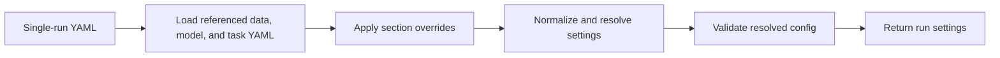

# Current configuration flow

## Summary

A current single-run file names data, model, and task YAML files. The loader reads them, merges overrides, resolves selected settings, and validates the result. This describes the inspected entry point, not every runner or the proposed next version.

## Evidence

1. `src/core/config.py:49` loads a YAML root mapping and rejects duplicate mapping keys using a custom safe loader.
2. `src/core/config.py:781` loads three references, merges per-section overrides, resolves selected settings, and calls `validate_experiment_config`.
3. `configs/experiment/raw_mse_offline_cpu_smoke.yaml` is one example with references, overrides, and run settings; it is not evidence that all run files have identical fields.
4. `configs/protocol/smd_window20_cleanval_q99_ewma09.yaml` supplies scoring and calibration values. `documents/specs/current-protocol-validation-rules.md` inventories relevant checks and explicitly identifies gaps.
5. `documents/specs/definitions.md` defines next-version terminology; it does not establish that the current implementation follows the proposed structure.

## Limits

This is a static, narrow reference, not a full audit of every entry point, profile, default, consumer, or artifact. No runtime behavior or compatibility was tested. The new design can replace the existing implementation.
