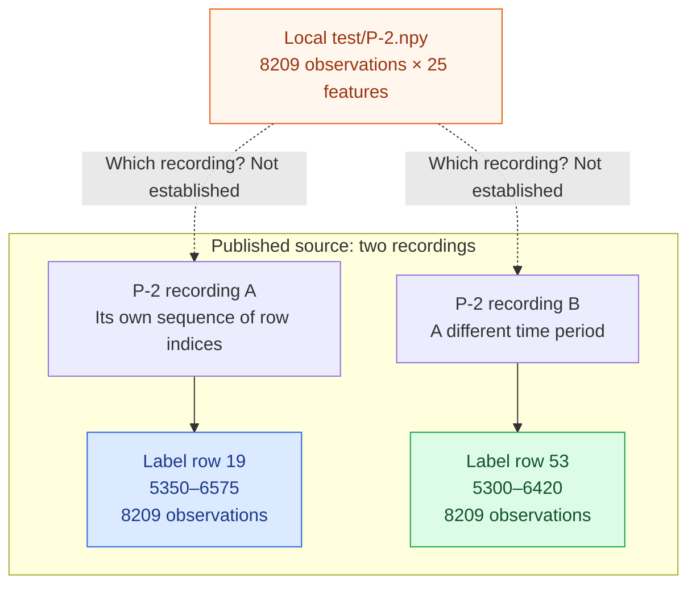

# NASA P-2 annotation review

Date: 2026-11-16.
Status: Source review complete. File-to-label mapping is unresolved. This review did not change data or code. Later approved work excluded P-2 and T-10 and completed the required NASA processing.

## Main finding

The two P-2 rows refer to separate recordings of the same channel at different times.
They are not two competing labels for one verified recording.
The dataset author explains this in [Telemanom issue 8, question 5](https://github.com/khundman/telemanom/issues/8).
The author says that the actual recording periods do not overlap.
The similar row indices occur by chance.

The earlier suggestion to combine these intervals would assign labels from two recordings to one file.
Do not combine them without evidence that both belong to the local file.

## Evidence checked

1. The [published label file](https://github.com/khundman/telemanom/blob/master/labeled_anomalies.csv#L19) has one SMAP P-2 row with interval `5350–6575` and length `8209`.
2. The [second published row](https://github.com/khundman/telemanom/blob/master/labeled_anomalies.csv#L53) has interval `5300–6420` and the same length.
3. The author confirms that indices start at zero in [issue 8, question 1](https://github.com/khundman/telemanom/issues/8).
4. At inspection, the local folder had one `train/P-2.npy` array of shape `(2821, 25)` and one `test/P-2.npy` array of shape `(8209, 25)`.
5. Both label rows pass the length check. Length alone cannot identify which row belongs to the local test array.
6. [OmniAnomaly preprocessing](https://github.com/NetManAIOps/OmniAnomaly/blob/master/data_preprocess.py#L38) explicitly excludes P-2 from its SMAP/MSL selection. That is a reference implementation choice; it does not identify either recording.

## Recording identity

The two source recording periods below are distinct.
Their calendar times are not available in the checked metadata.

## What remains unknown

1. The checked published CSV still contains both rows. It does not provide a unique recording identifier for each P-2 row.
2. No verified correction or authoritative mapping to the local array was found in this review.
3. GitHub file-history and API requests failed during this review. The history check is incomplete.
4. A plot of the local signal can show its values, but cannot prove the correct label interval without a known reference recording.

## Final decision and status

1. The user approved excluding P-2. The later T-10 exclusion also applies. Do not merge P-2 intervals or invent labels.
2. All required NASA data is processed: 80 selected channels. One complete prepared version remains.
3. After saved-output verification, the original NASA folder was removed, including excluded channel arrays and the source annotation file. This replaces the earlier recommendation to keep those files locally.
4. Reconsider P-2 only when a verified source and file-to-label mapping are available. The mapping remains unresolved.
5. See [the confirmed decisions](../plan/decisions-tsad-preprocess.md). Shapes and file observations above describe the source before deletion.
