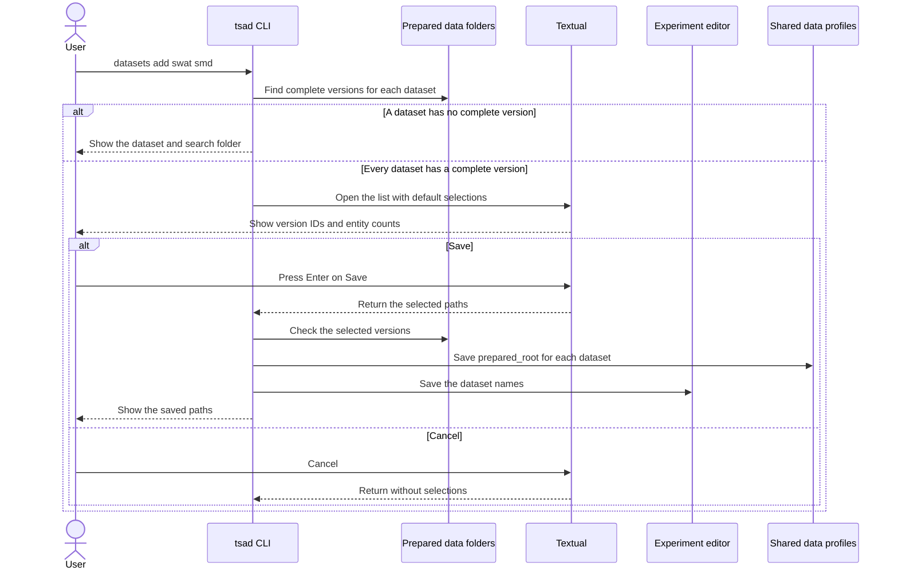

# Dataset selection and runtime cleanup

Date: 2026-11-20

Status: Installed picker and runtime cleanup checked on 2026-11-20.

## Confirmed requirements

1. Use Textual when the user runs `datasets add` in a terminal. Show one version selection per dataset.
2. Reuse the current CLI. Add at most two commands.
3. Propose a smaller `src/` tree. Use the runtime replacement plan to review legacy files for removal.

## User flows

1. List datasets and methods. Run `preprocess` when source data is available and a new version is necessary.
2. Create an experiment. Run `datasets add` to select prepared versions. Run `methods add` to select methods. Use `experiment set` to change seeds or provider settings.
3. Use `experiment show` to read the selected settings. Run `validate` to check the experiment. Run a smoke check before the full experiment.
4. Use `resume` to continue an interrupted run. Use `report` to make result tables.

## Decisions and conflicts

| Topic | Decision or proposal | Alignment check |
| --- | --- | --- |
| Where to save versions | Confirmed. Save the selected path in `prepared_root` in the shared data profile. Save dataset names in the experiment YAML. | This follows the profile contract. New plans for any experiment or standalone that uses this profile see the new path. Show this effect before Save. Saved run settings keep their original paths. |
| Default version | Select the version in the shared profile first if its manifest passes the initial checks. If it is unavailable, select the most recent complete manifest by file modification time. | SWaT pins `67e1e175…`. The checked SWaT preprocessing record gives the same ID. The other manifest, `83957f47…`, has a later modification time. The manifests have no creation date. |
| Scripts and SSH | Use the same command. Open Textual in an interactive terminal, including an SSH session with a terminal. Use the defaults when the command runs without a terminal. | The installed command works in scripts. Test that scripts can still add datasets. Show the paths the command saves. |
| Old workflows | Confirmed. Retire all callers that require the old runtime. Keep the replacement runtime and move the numerical code it calls into its current owners. | This decision clears legacy-only callers for removal. Phase 11 still requires a path and caller check. Keep prepared data, historical results, thesis files, reference evidence, licenses, preprocessing, and the documentation hook. |
| Run recovery | Confirmed. No paused runs need to continue. Keep the current identity checks. | The runtime hashes Python contents and paths. New runs can need new offline checkpoints. Keep historical results. |
| Keyboard | Use Tab to move to Save. Press Enter to save. Use Enter inside an open version list to choose a version. Use Esc to close the open list. Use Cancel to exit without saving. | Test the complete flow with keyboard input. A mouse click on Save is optional. |

## How the current runtime checks a version

1. The data profile gives the path in `prepared_root`. For generated cells, `_default_cells()` reads the manifest to get the entity names.
2. `resolve_run()` uses `_prepared_identity()`. This function checks the manifest status, the requested entity, and the scaler entry. It records the version ID, the manifest hash, and the expected scaler hash.
3. During experiment validation, `load_entity()` checks that the version ID matches the folder name. It checks the hashes of the scaler and the train, validation, and test files. It also checks the feature order, row counts, labels, and timestamps when present.
4. Confirmed. Use manifest metadata to make the TUI list. Check the selected versions before writing the profiles. Keep the runtime checks when the user runs `validate`.

## Source tree

The source tree went from 136 Python files in 15 subfolders to 37 files
in two subfolders. Baselines are directly in `methods/`.
`protocols.py` contains the four validation contexts.
The [cleanup map](runtime-cleanup-paths.csv) lists the retired paths.

## Initial checks

1. The installed CLI lists all five datasets.
2. Pytest reports 165 passes and two failures. Both failures refer to missing old experiment YAML files.
3. The old YAML files in the runtime path map are already absent from the checkout. The cleanup must account for their remaining callers.

## Work order

1. **Confirm the design.**
   - [x] Read the current runtime and earlier decisions. Tools: `rg` and file reader.
   - [x] Check the installed dataset list. Tool: `tsad`.
   - [x] Record the shared path, default priority, and legacy scope. Tool: Markdown.
   - [x] Check these decisions against the current contract. Tools: `rg` and file reader.
   - [x] Record the run recovery decision. Tool: Markdown.
2. **Add version selection.**
   - [ ] Connect version discovery to the current CLI. Tool: Python.
   - [ ] Add the selection screen. Tool: Textual.
   - [ ] Save the selected paths in the shared data profiles. Tool: Python.
   - [ ] Check Save, Cancel, missing data, and script use. Tools: pytest and Textual Pilot.
3. **Remove replaced files.**
   - [ ] List the removal paths and retained callers. Tools: Git and `rg`.
   - [ ] Move the live numerical code. Tool: Python.
   - [ ] Remove the cleared paths. Tool: file editor.
   - [ ] Check the installed CLI on one prepared-data combination. Tool: `tsad`.
   - [ ] Run the retained suite. Tool: pytest.
   - [ ] Review the final changes and source counts. Tools: Git and Python.

No domain terms change. A prepared version is a saved preprocessing output with a version ID.

[CLI design](../../../specs/desired-cli-20261109.md) · [Runtime plan](../../2026-11-16/plan/plan-implement-runtime-signatures.md) · [Runtime profile contract](../../2026-11-16/detail/runtime-profile-contract.md) · [Prepared data location](prepared-data-location.md) · [Textual Select](https://textual.textualize.io/widgets/select/)
