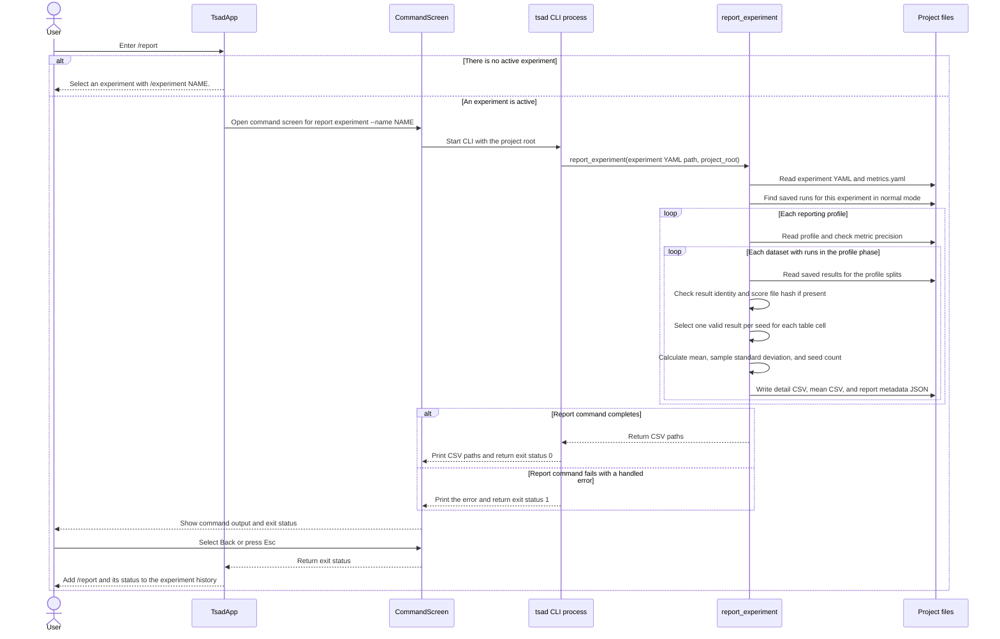

# Sequence diagram for `/report`

Open an experiment with `/experiment NAME`. Enter `/report` to make tables from the saved results of normal runs. For example, in the `smd_comparison` session, `/report` runs the same command as `tsad report experiment --name smd_comparison`.

## Table rules

1. The reporting profile specifies the phase, splits, and metrics. The experiment definition specifies the expected seeds.
2. For each cell, the report uses the most recent successful attempt for each expected seed that has a finite value for that metric. The command stops if the selected attempts have incompatible configurations.
3. The detail CSV shows the mean, sample standard deviation, and the number of valid seeds out of the expected seeds. The mean CSV shows the mean only. The report writes `N/A` for a missing mean or standard deviation.
4. The output directory is `outputs/experiments/NAME/reports/DATASET/`. Each profile writes `PROFILE_detail.csv`, `PROFILE_mean.csv`, and `PROFILE.json`. The command prints the two CSV paths.
5. If no dataset has runs for any selected profile phase, the command returns exit status `0` with no CSV paths. If a later profile or dataset fails, files written earlier can remain.

[Slash command design](tsad-slash-tui-design.md) · [Textual interface](../../../../src/tui.py) · [CLI](../../../../src/cli.py) · [Report code](../../../../src/reporting.py)
