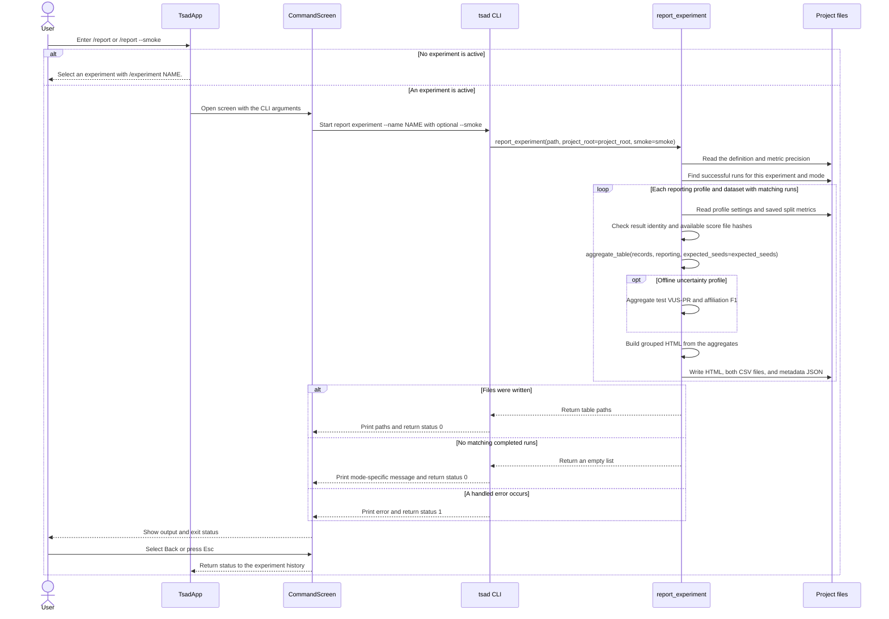

# Proposed design for `/report`

**Status** — Final design for review before implementation.

The current command reads saved normal results and writes two CSV files and a JSON file for each dataset and reporting profile. This design adds grouped HTML tables and an option to report on smoke runs.

## Command and output

1. Run `/report` for normal runs. Run `/report --smoke` for smoke runs. The equivalent CLI command is `tsad report experiment --name NAME [--smoke]`.
2. Read successful `run.json` records for the active experiment and selected mode. Read the saved split metrics from `result.json`. Use all configured seeds for normal reports. Use the first configured seed for smoke reports, as the smoke planner does.
3. Write `PROFILE.html` with the current `PROFILE_detail.csv`, `PROFILE_mean.csv`, and `PROFILE.json` in `outputs/experiments/NAME/reports/DATASET/` or `outputs/smoke/NAME/reports/DATASET/`. Print the CSV and HTML paths in the command screen.
4. If no successful runs match the selected mode and any reporting profile phase, show `No completed runs to report in MODE mode.` and return exit status `0`. If a saved result has an invalid identity or hash, show the error and return exit status `1`.

The files in `reporting/` supply the layouts. The runtime reads current `run.json` and `result.json` artifacts from the selected experiment directory.

## Sequence diagram



## Table layout

Use one row per method and reporting variant. Use the same column width for all metric columns within a table.

| Table | Columns in each entity group, from left to right | Position of Average |
| --- | --- | --- |
| Offline detection | VUS-PR, Aff. F1, VUS-ROC, FPR | Last group on the right |
| Online detection | VUS-PR, Aff. F1, VUS-ROC, FPR | Last group on the right |
| Offline uncertainty | Test VUS-PR, test Aff. F1, validation uncertainty, test uncertainty | Below the entity rows, aligned with the first entity group |

1. Give each entity header and each Average header the full width of its four metric columns. The header-to-column width ratio is 4:1 in all three templates. Let long labels wrap. Use compact columns to fit the table inside the right margin when there is sufficient space. If the window is too narrow, let the user scroll to the last column.
2. Make one detection table per selected split. Use the display order above for the selected detection metrics. Put other selected metrics after them in profile order. If a profile selects a different number of metrics, span exactly that number of equal-width columns.
3. For the offline uncertainty profile `uncertainty.yaml`, make one table for each configured metric in profile order. Use the metric name in the table title. Label its four columns `VUS-PR`, `Aff. F1`, `Validation`, and `Test`. Add a note that VUS-PR and Aff. F1 use the test split. Keep the current CSV columns for this profile.
4. Hide Average if only one entity appears.

## Values and ranking

1. Read `segment_mean_vus_pr`, `segment_mean_affiliation_f1`, `segment_mean_vus_roc`, and `fpr` for the four detection metrics. For the first two columns in each uncertainty group, aggregate `segment_mean_vus_pr` and `segment_mean_affiliation_f1` from the test split of the same offline runs. Apply the shared precision to these two columns. Apply the profile precision rules to the other columns.
2. For each cell, use the latest successful attempt with a finite value for each expected seed. Keep the existing check for incompatible configurations. Show the mean. Add `(valid/expected)` for a mean with partial seed coverage. Show `N/A` when no valid value is available. Keep the sample standard deviation and seed counts in the detail CSV.
3. Calculate Average separately for each metric column. Give each displayed entity the same weight. Show `N/A` if any displayed entity is missing a value for an expected seed. Use the entities in the successful runs for the dataset and profile phase.
4. Rank each detection column across the displayed method rows. Rank only values with full seed coverage and use values before rounding. Use bold for the best value and underline for the second distinct value. Give equal values the same rank. Higher is better for VUS-PR, VUS-ROC, and Aff. F1. Lower is better for FPR. Use plain values for uncertainty tables and metrics without a ranking rule.
5. Label smoke HTML as `Smoke run report`. The saved SWaT smoke runs can show FPR. Their three segment-mean detection metrics are unavailable and show as `N/A`.

## Python signatures

Reuse `TsadApp` and `CommandScreen`. The existing resolver forwards `--smoke` to the CLI parser for `/report`. Add the option to the `report experiment` parser. Pass its value to the reporter. List `/report [--smoke]` in the TUI help. Use functions for the table work.

```python
# src/tui.py — existing signatures
def resolve_cli_arguments(words: Sequence[str], *,
                          experiment_name: str | None) -> tuple[str, ...]: ...

class TsadApp(App[int]):
    def on_input_submitted(self, event: Input.Submitted) -> None: ...

class CommandScreen(ModalScreen[int]):
    async def run_with_output(self) -> int: ...

# src/cli.py — existing signatures, add report parser option and dispatch
def _parser(): ...
def _execute(command, root): ...

# src/reporting.py — add smoke option, reuse discovery and aggregation
def report_experiment(path: Path, *, project_root: Path,
                      smoke: bool = False) -> list[Path]: ...
def _split_record(run, split): ...
def aggregate_table(runs, reporting: dict, *, expected_seeds) -> dict: ...

# src/reporting.py — proposed HTML and presentation functions
def _render_report_html(table: dict, profile: dict, precision: dict[str, int], *,
                        experiment_id: str, dataset: str, smoke: bool,
                        detection_context: dict | None = None) -> str: ...
def _entity_average(cells: Sequence[dict]) -> float | None: ...
def _metric_ranks(values: Sequence[float | None], *,
                  higher_is_better: bool) -> list[int | None]: ...
```

`_render_report_html` takes the current aggregate with columns keyed by split, entity, and metric. For uncertainty, pass a test-only aggregate of VUS-PR and affiliation F1 from the same records. Merge those columns by method, reporting variant, and entity during rendering. The renderer escapes labels and builds a standalone HTML file. `report_experiment` writes the HTML with the existing atomic writer.

## Acceptance checks

1. Run the normal and smoke reports for the same experiment. Check that each command uses its own run directory and writes its four report files beside each other.
2. Use saved results with repeated attempts, missing metrics, partial seed coverage, and tied values. Check that the HTML shows the correct means, counts, averages, and ranks.
3. Check the rendered HTML for all three table types. Measure each four-column entity and Average header against its metric columns. Check that the uncertainty Average has the same column boundaries as the first entity group.
4. Use an experiment without matching successful runs. Check the message and status `0`. Use a saved result with an invalid identity or hash. Check the error and status `1`.

## Terminology and preview

Experiment, run, method, variant, and entity keep their current meanings. The report uses saved metrics. The preview shows sample values for the layout.

[Rendered preview PDF](report-preview/report-table-preview.pdf) · [Reference tables](../../../../reporting/README.md) · [Offline uncertainty reference](../../../../reporting/offline_phase_tables/offline_phase_metric_table_report2.md) · [Current command flow](tsad-report-sequence.md) · [Reporting code](../../../../src/reporting.py) · [CLI specification](../../../specs/desired-cli-20261109.md)
