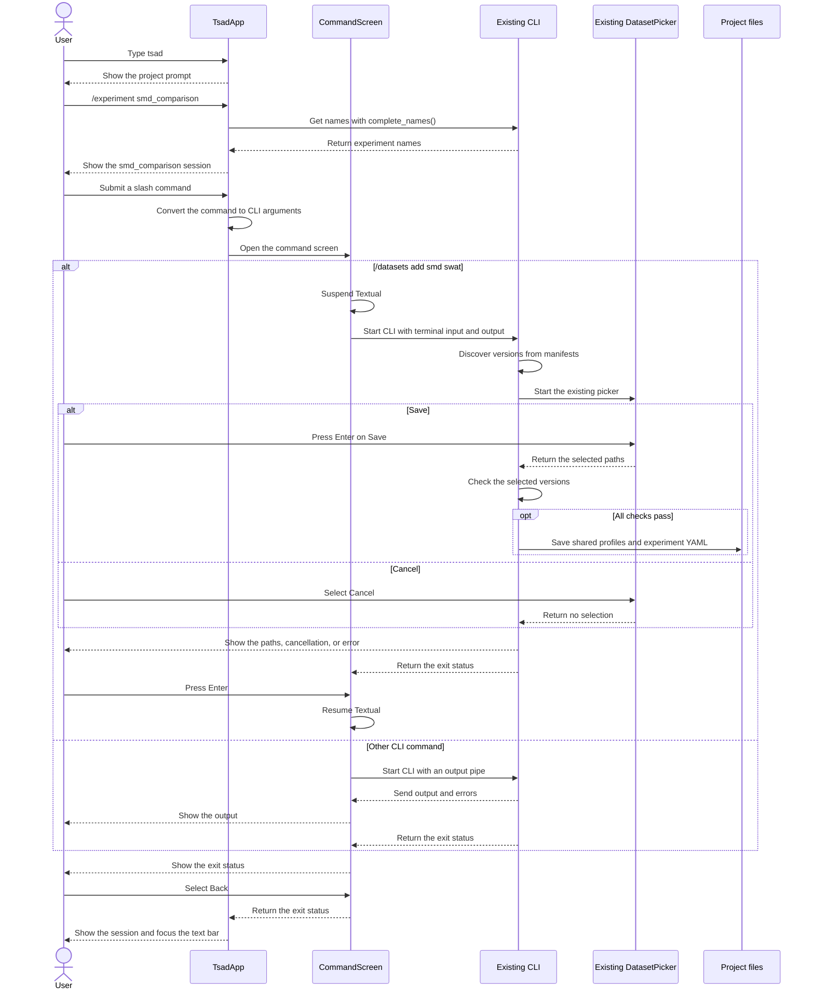

# TSAD terminal user interface

Date 2026-11-20. Proposed for approval. This document specifies a design.

## Entry and session

1. Type `tsad` in an interactive terminal to open the Textual app. Start at the project prompt with no experiment selected.
2. Type `/list experiments` to see the available experiments. Type `/experiment NAME` to open its session.
3. The session shows the experiment name, the command history, and one text bar. Type a slash command and press Enter. Use `/experiment NAME` again to change sessions.
4. The app keeps each experiment's command history in memory until the app closes. The existing experiment YAML and run files hold the saved state. A session is a view of one experiment. The definition of an experiment stays the same.
5. Commands with CLI arguments continue through the current parser. Examples are `tsad --help` and `tsad list datasets`. With redirected input or output, bare `tsad` keeps the current CLI behavior.

## Slash commands

In the table, `ACTIVE` is the selected experiment name. The CLI column shows arguments after `tsad`. Text in square brackets is optional.

| Text bar | CLI arguments or app action |
| --- | --- |
| `/experiment NAME` | Open the session for NAME. Check the name with the existing experiment list. |
| `/list KIND` | `list KIND`. Use `experiments`, `datasets`, `methods`, or `standalones`. |
| `/new NAME` | `new experiment --name NAME`. Use `/experiment NAME` to open the new session. |
| `/show` | `experiment --name ACTIVE show` |
| `/datasets add smd swat` | `experiment --name ACTIVE datasets add smd swat`. Open the existing version picker. |
| `/datasets remove swat` | `experiment --name ACTIVE datasets remove swat` |
| `/methods add mustard candi m2n2` | `experiment --name ACTIVE methods add mustard candi m2n2` |
| `/methods remove candi` | `experiment --name ACTIVE methods remove candi` |
| `/set FIELD VALUE [VALUE ...]` | `experiment --name ACTIVE set FIELD VALUE [VALUE ...]`. Use the existing field names and values. |
| `/validate` | `validate experiment --name ACTIVE` |
| `/run [--smoke]` | `run experiment --name ACTIVE [--smoke]` |
| `/resume` | `resume experiment --name ACTIVE` |
| `/report` | `report experiment --name ACTIVE` |
| `/run standalone NAME` | `run standalone --name NAME` |
| `/preprocess OPTIONS` | `preprocess OPTIONS`. Pass the current flags, such as `--dataset smd --show-profile`. |
| `/completion SHELL` | `completion SHELL`. Show the shell script as text. |
| `/_complete KIND [PREFIX]` | `_complete KIND [PREFIX]`. This is a shell helper. Omit it from `/help`. |
| `/help`, `/quit` | Show the slash commands or close the app. |

Commands that require `ACTIVE` show an instruction if no experiment is selected. The app shows an error for an unknown slash command or incomplete quotation marks. The existing CLI checks the command arguments. It also does all project operations.

## Sequence diagram

The same Textual command screen receives each CLI command. For most commands, the screen shows output as the CLI produces it. For `/datasets add`, the screen gives the terminal to the current CLI so it can start the existing picker. When that command ends, press Enter to return to the command screen. The command screen shows the exit status. Use **Back** to return to the text bar.



## Proposed Python signatures

Put the new types and functions in `src/tui.py`. The signatures specify the interfaces.

```python
@dataclass
class ExperimentSession:
    name: str
    history: list[str] = field(default_factory=list)


def launch_tui(project_root: Path) -> int: ...

def resolve_cli_arguments(
    words: Sequence[str], *, experiment_name: str | None
) -> tuple[str, ...]: ...

def build_cli_process_arguments(
    arguments: Sequence[str], *, project_root: Path
) -> tuple[str, ...]: ...


class TsadApp(App[int]):
    def __init__(self, project_root: Path) -> None: ...
    def compose(self) -> ComposeResult: ...
    def on_input_submitted(self, event: Input.Submitted) -> None: ...
    def open_experiment(self, name: str) -> None: ...
    def record_command_result(self, exit_status: int | None) -> None: ...


class CommandScreen(ModalScreen[int]):
    def __init__(
        self, arguments: Sequence[str], *, project_root: Path
    ) -> None: ...
    def compose(self) -> ComposeResult: ...
    def on_mount(self) -> None: ...
    async def run_command(self) -> None: ...
    def run_with_terminal(self) -> int: ...
    async def run_with_output(self) -> int: ...
    def action_interrupt(self) -> None: ...
    def action_back(self) -> None: ...
```

1. `TsadApp` owns the selected session and its command history. It splits quoted input with `shlex.split`. It handles session commands in the app. It sends other commands to `resolve_cli_arguments`.
2. `resolve_cli_arguments` adds the active experiment name where necessary. `build_cli_process_arguments` starts from the current Python interpreter and uses the installed CLI module. Pass arguments as a list to the process API. Use no shell.
3. `CommandScreen` starts one command after Textual displays the screen. `run_with_terminal` uses `App.suspend()` and gives the CLI the terminal. `run_with_output` sends standard output and standard error to one scrollable log. While a command runs, keep **Back** disabled. Ctrl+C sends an interrupt to the running command. The current CLI controls run recovery.
4. The command history records the command and exit status. The command screen contains its output until **Back**. For the picker, read the exact result in the terminal. Cancel and Save can both return status 0.
5. In `src/cli.py`, keep `main(argv: Sequence[str] | None = None) -> int`. Add the interactive entry and a module entry point for the child process. Reuse `complete_names(kind: str, prefix: str, *, project_root: Path) -> list[str]` and the current command handlers. Reuse `DatasetPicker(App[dict[str, Path] | None])` and `add_datasets` through the current CLI.

## Decisions and checks

1. **Requested.** Bare `tsad` opens the app. Each experiment has a session. All CLI actions use the slash text bar.
2. **Proposed.** Use `/experiment NAME` to select a session. Keep history in memory. Use one command screen for the CLI actions and the existing picker for prepared versions.
3. **Alignment.** Save still checks the prepared data before it writes the shared data profiles. Other experiments that use those profiles can use the new versions in new plans. Cancel makes no file changes.
4. **Compatibility.** The current run identity includes Python source file paths and contents. The TUI code change can affect resume and checkpoint reuse for runs made before the change. Keep the current identity checks.
5. **Verification after approval.** Check the slash mappings with pytest. Check interactive entry, session changes, picker Save and Cancel, CLI errors, and Ctrl+C in a terminal. Use a disposable project for checks that write files.
6. **Terminology.** Add *session* as a TUI term. The experiment, run, and data profile terms keep their current meanings.

[Existing CLI](../../../../src/cli.py) · [Existing picker](../../../../src/dataset_picker.py) · [Dataset selection decisions](dataset-selection-and-cleanup-decisions.md) · [Current CLI requirements](../../../specs/desired-cli-20261109.md)

[Textual screens](https://github.com/textualize/textual/blob/v8.2.8/docs/guide/screens.md) · [Textual terminal suspension](https://github.com/textualize/textual/blob/v8.2.8/docs/guide/app.md#suspending) · [ASD-STE100 Issue 9](https://www.asd-ste100.org/assets/files/ASD-STE100_ISSUE9.pdf)
