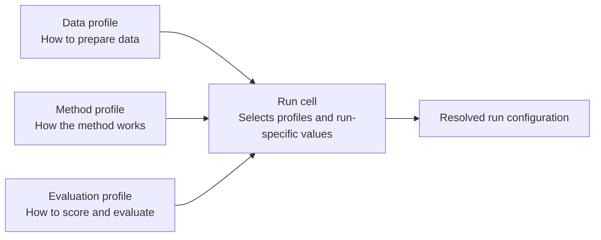

# Config profiles and run cell

Status: proposed design for the next version of `bachelor-thesis-2026`.

A run cell selects profiles and provides settings for one run. The resolver combines them into a resolved run configuration.

The profiles hold settings. The four protocols contain validation rules for inputs and outputs in their respective contexts; they are separate from the profiles.
